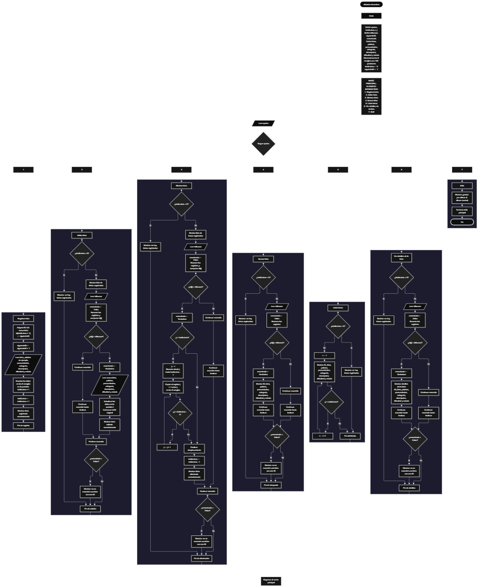

Este proyecto, llamado <b>alfabeto interactivo</b>, fue desarrollado en <b>pseint</b> como un ejercicio práctico para fortalecer la lógica de programación mediante la creación de un sistema de gestión de letras desde la consola. El programa cuenta con un menú principal de siete opciones que permite <b>registrar, editar, eliminar, buscar, listar y consultar la información completa</b> de las letras registradas. Cada letra almacena datos como el identificador, la letra, la palabra de ejemplo, la pronunciación, la categoría, la descripción, la dificultad y el estado, utilizando ocho arreglos con una capacidad definida de <b>100 posiciones durante la ejecución</b>. Durante su desarrollo se aplicaron conceptos fundamentales de programación, como variables, arreglos, estructuras condicionales, ciclos repetitivos y estructuras de selección, además de procesos para buscar, modificar, eliminar y organizar registros. Este proyecto permite poner en práctica los conocimientos adquiridos en PSeInt y sirve como base para desarrollar sistemas de gestión más avanzados utilizando otros lenguajes y tecnologías.

<h2 align="center">⚙️ Funcionamiento del menú principal</h2>

### ➕ Registrar letra

La opción <b>1) registrar letra</b> permite almacenar una nueva letra en el sistema. Al comenzar el registro, el programa asigna automáticamente un identificador consecutivo utilizando la variable <b>siguienteID</b>. A continuación, solicita la <b>letra, palabra de ejemplo, pronunciación, categoría, descripción, dificultad y estado</b>. Los datos se almacenan en la misma posición de sus respectivos arreglos, utilizando la posición <b>totalLetras + 1</b>. Finalmente, la variable <b>totalLetras</b> aumenta en uno y se muestra el mensaje <b>"letra registrada correctamente."</b>. El código actual no comprueba si se ha alcanzado la capacidad máxima de 100 posiciones antes de registrar una nueva letra.

### ✏️ Editar letra

La opción <b>2) editar letra</b> permite modificar la información de una letra registrada. Primero, el programa comprueba si existen letras almacenadas mediante la variable <b>totalLetras</b>. Si no hay registros, muestra el mensaje <b>"no hay letras registradas."</b>. En caso contrario, presenta una lista con el ID, la letra, la palabra, la pronunciación, la categoría, la descripción, la dificultad y el estado de cada registro. Después, solicita el identificador de la letra que se desea editar y utiliza la variable <b>idBuscar</b> para localizarlo. Si encuentra una coincidencia, cambia la variable lógica <b>encontrado</b> a <b>verdadero</b> y solicita la nueva letra, palabra, pronunciación, categoría, descripción, dificultad y estado, actualizando directamente los valores de los arreglos correspondientes. El identificador original se conserva. Finalmente, presenta el mensaje <b>"letra editada correctamente."</b>. Si el identificador no corresponde a una letra registrada, muestra el mensaje <b>"no se encontró una letra con ese id."</b>.

### 🗑️ Eliminar letra

La opción <b>3) eliminar letra</b> permite eliminar una letra registrada mediante su identificador. Antes de comenzar, el programa comprueba que existan letras almacenadas. Si no hay registros, muestra el mensaje <b>"no hay letras registradas."</b>. Si hay registros disponibles, presenta una lista con el ID, la letra, la palabra, la pronunciación, la categoría, la descripción, la dificultad y el estado de cada letra. Después, solicita el identificador de la letra que se desea eliminar y utiliza la variable <b>encontrado</b> para comprobar si existe. Si encuentra el registro, comienza el proceso de eliminación. Para mantener los registros organizados, utiliza un ciclo <b>para</b> controlado por la variable <b>j</b>, que desplaza una posición hacia atrás los datos de las letras posteriores en los ocho arreglos <b>id, letra, palabra, pronunciacion, categoria, descripcion, dificultad y estado</b>. Posteriormente, disminuye la variable <b>totalLetras</b> en uno y muestra el mensaje <b>"letra eliminada correctamente."</b>. Si el identificador no corresponde a una letra registrada, informa que no se encontró una letra con ese ID.

### 🔎 Buscar letra

La opción <b>4) buscar letra</b> permite localizar una letra mediante su identificador. Primero, el programa comprueba si existen letras registradas. Si no hay registros, muestra el mensaje <b>"no hay letras registradas."</b>. En caso contrario, inicializa la variable lógica <b>encontrado</b> con el valor <b>falso</b> y solicita el identificador de la letra que se desea buscar. A continuación, utiliza un ciclo <b>para</b> para recorrer los identificadores almacenados y compararlos con el valor introducido mediante la condición <b>id[i] = idBuscar</b>. Cuando encuentra una coincidencia, cambia la variable <b>encontrado</b> a <b>verdadero</b> y muestra el ID, la letra, la palabra, la pronunciación, la categoría, la descripción, la dificultad y el estado del registro. Si finaliza el recorrido sin encontrar coincidencias, presenta el mensaje <b>"no se encontró una letra con ese id."</b>. La búsqueda compara el identificador introducido con los identificadores almacenados en el arreglo.

### 📋 Listar letras

La opción <b>5) listar letras</b> permite visualizar todas las letras registradas actualmente en el sistema. Antes de mostrar la información, el programa comprueba si la variable <b>totalLetras</b> es igual a cero. Si no existen registros, presenta el mensaje <b>"no hay letras registradas."</b>. Si hay letras disponibles, utiliza un ciclo <b>para</b> para recorrer los arreglos desde la primera posición hasta el número total de letras registradas. Durante el recorrido, muestra el ID, la letra, la palabra, la pronunciación, la categoría, la descripción, la dificultad y el estado de cada registro. Esta función facilita consultar todas las letras existentes sin necesidad de buscarlas individualmente.

### 📄 Ver detalles de la letra

La opción <b>6) ver detalles de la letra</b> permite consultar todos los datos de una letra específica. Primero, el programa comprueba si existen letras registradas. Si no hay registros, muestra el mensaje <b>"no hay letras registradas."</b>. En caso contrario, solicita el identificador de la letra que se desea consultar y utiliza la variable <b>idBuscar</b> para localizarla. Durante el recorrido, compara los identificadores almacenados con el valor introducido. Si encuentra una coincidencia, cambia la variable <b>encontrado</b> a <b>verdadero</b> y muestra por separado los datos completos del registro: <b>ID, letra, palabra, pronunciación, categoría, descripción, dificultad y estado</b>. Si el identificador no corresponde a ninguna letra registrada, presenta el mensaje <b>"no se encontró una letra con ese id."</b>.

### 🚪 Salir del menú principal

La opción <b>7) salir</b> está destinada a finalizar la ejecución del programa y muestra el mensaje <b>"gracias por utilizar el álbum musical."</b>. El menú principal se encuentra dentro de una estructura repetitiva <b>repetir ... hasta que</b>, que mantiene el programa en funcionamiento mientras se realizan las operaciones disponibles. En el código actual, la condición final es <b>hasta que opcion = 7</b>, por lo que seleccionar la opción 7 finaliza el ciclo principal. El mensaje de despedida todavía menciona un álbum musical, aunque el nombre del proyecto es <b>alfabeto interactivo</b>.

<h2 align="center">🧠 Temas aplicados en el proyecto</h2>

### 📦 Variables

En este proyecto se utilizan variables para guardar la opción seleccionada en el menú, controlar la cantidad de letras registradas, recorrer los arreglos, seleccionar las letras que se desean editar, eliminar o consultar, almacenar el identificador que se desea buscar y comprobar si se encontró una coincidencia. Cada variable cumple una función específica dentro de las operaciones de gestión de letras.

🔢 **Opcion:** Almacena la opción seleccionada por el usuario en el menú principal.

📊 **TotalLetras:** Almacena la cantidad actual de letras registradas.

🔄 **I:** Funciona como contador en los ciclos <b>para</b> y permite recorrer las posiciones de los arreglos.

🔁 **J:** Controla el recorrido utilizado para desplazar los datos durante la eliminación de una letra.

🔎 **IdBuscar:** Almacena el identificador introducido por el usuario para buscar, editar, eliminar o consultar una letra.

🆔 **SiguienteID:** Genera identificadores consecutivos para las nuevas letras registradas.

✅ **Encontrado:** Variable lógica que indica si se encontró una letra con el identificador solicitado.

📝 **Letra, Palabra, Pronunciacion, Categoria, Descripcion, Dificultad y Estado:** Variables utilizadas para definir los datos que almacena cada letra.

### 🗃️ Arreglos

En este proyecto se utilizan ocho arreglos relacionados con los datos de cada letra. Cada arreglo tiene una capacidad definida de <b>100 posiciones</b> y utiliza el mismo índice para representar la información correspondiente a una misma letra. Por ejemplo, los datos de una letra almacenada en la posición <b>1</b> se encuentran distribuidos entre <b>id[1], letra[1], palabra[1], pronunciacion[1], categoria[1], descripcion[1], dificultad[1] y estado[1]</b>. Esta organización permite recorrer, buscar, modificar, mostrar y eliminar las letras de manera ordenada.

🆔 **Id[100]:** Almacena los identificadores de las letras registradas.

🔤 **Letra[100]:** Almacena las letras registradas.

📝 **Palabra[100]:** Almacena las palabras de ejemplo de cada letra.

🗣️ **Pronunciacion[100]:** Almacena la pronunciación de cada letra.

📂 **Categoria[100]:** Almacena la categoría de cada letra.

📄 **Descripcion[100]:** Almacena las descripciones de las letras.

📊 **Dificultad[100]:** Almacena la dificultad asignada a cada letra.

✅ **Estado[100]:** Almacena el estado de cada registro.

### 🔀 Estructuras condicionales

En este proyecto se utilizan las estructuras <b>si</b> y <b>sino</b> para comprobar si existen letras registradas antes de realizar determinadas operaciones, determinar si un identificador coincide con alguno de los almacenados, comprobar si se encontró una letra y decidir qué mensaje mostrar. Durante la eliminación, también se utiliza una condición para comprobar si la posición del registro es menor que el total de letras. Estas condiciones permiten que el programa responda de manera diferente según el estado de los registros y el resultado de cada operación.

### 🔄 Estructuras repetitivas

En este proyecto se utilizan los ciclos <b>para</b> y <b>repetir ... hasta que</b>. Los ciclos <b>para</b> permiten recorrer los arreglos para mostrar las letras, buscar identificadores y acceder a los registros seleccionados. Durante la eliminación, también se utilizan para desplazar los datos de las letras posteriores una posición hacia atrás. Por otro lado, el ciclo <b>repetir ... hasta que</b> mantiene activo el menú principal para que el usuario pueda ejecutar diferentes operaciones antes de salir del programa.

### 🎯 Estructura según

El programa evalúa el valor almacenado en la variable <b>opcion</b> y ejecuta el bloque de instrucciones correspondiente. Cada caso representa una operación específica del sistema: <b>registrar letra, editar letra, eliminar letra, buscar letra, listar letras, ver detalles de la letra o salir</b>. También se utiliza el bloque <b>de otro modo</b> para mostrar el mensaje <b>"opción no válida."</b> cuando el valor introducido no coincide con ninguna de las opciones definidas.

### 🔢 Dimensionamiento de arreglos

El programa utiliza la instrucción <b>dimension</b> para establecer la capacidad de los arreglos que almacenan la información de las letras. Se definieron <b>100 posiciones</b> para cada uno de los ocho arreglos, lo que permite organizar los datos de las letras durante la ejecución. La cantidad de posiciones ocupadas se controla mediante la variable <b>totalLetras</b>, mientras que la variable <b>siguienteID</b> permite generar identificadores consecutivos para los nuevos registros. El código actual no incorpora una comprobación que impida superar las 100 posiciones definidas.

### 🔄 Reorganización de registros

Cuando se selecciona una letra para eliminarla, el programa utiliza un ciclo <b>para</b> que comienza en la posición seleccionada y llega hasta <b>totalLetras - 1</b>, siempre que la posición eliminada sea anterior a la última. En cada repetición, los datos de la posición siguiente se copian sobre la posición actual en los ocho arreglos: <b>id, letra, palabra, pronunciacion, categoria, descripcion, dificultad y estado</b>. Después, la variable <b>totalLetras</b> disminuye en uno. De esta manera, los registros posteriores ocupan las posiciones disponibles sin dejar espacios entre los registros activos. El código no limpia explícitamente los valores que quedan en la última posición después de la eliminación.

<h2 align="center">¿Cómo se implementaron las operaciones crud en el proyecto?</h2>

Las operaciones <b>crud</b> se implementaron mediante las opciones del menú principal, permitiendo administrar las letras registradas. La operación <b>crear</b> corresponde a <b>registrar letra</b>, donde se introducen los datos de una nueva letra; <b>leer</b> se realiza mediante las opciones <b>buscar letra, listar letras y ver detalles de la letra</b>; <b>actualizar</b> corresponde a <b>editar letra</b>, donde se modifican los datos de una letra registrada; y <b>eliminar</b> se realiza mediante la opción <b>eliminar letra</b>. Estas operaciones utilizan variables, arreglos, condicionales y ciclos para gestionar la información almacenada temporalmente durante la ejecución del programa.

<h2 align="center">Diagrama de flujo del proyecto</h2>

<h2 align="center">🛡️ Validaciones del programa</h2>

### 📭 No existen letras registradas

Esta validación se utiliza en las opciones de <b>editar, eliminar, buscar, listar y ver detalles de la letra</b>. El programa comprueba si la variable <b>totalLetras</b> es igual a <b>0</b> y, si no existen letras registradas, muestra el mensaje <b>"no hay letras registradas."</b>. Esta comprobación evita continuar con las operaciones que necesitan información almacenada cuando el sistema está vacío.

### ⚠️ Capacidad de los arreglos

Los ocho arreglos están dimensionados para almacenar hasta <b>100 posiciones</b>. Sin embargo, a diferencia de un sistema que controla explícitamente la capacidad disponible, el código actual no comprueba la condición <b>totalLetras &lt; 100</b> antes de registrar una nueva letra. Por este motivo, el programa no impide que se intente registrar información por encima de las posiciones dimensionadas. Para evitarlo, sería necesario incorporar una validación de capacidad en la opción de registro.

### ❌ Letra no encontrada

Esta validación se utiliza durante las operaciones de búsqueda, edición, eliminación y consulta de detalles. El programa inicializa la variable lógica <b>encontrado</b> con el valor <b>falso</b> y recorre el arreglo <b>id</b> para comparar cada identificador con el valor introducido por el usuario. Cuando encuentra una coincidencia, cambia la variable a <b>verdadero</b> y ejecuta la operación correspondiente. Si al finalizar el recorrido la variable <b>encontrado</b> continúa siendo <b>falso</b>, muestra el mensaje <b>"no se encontró una letra con ese id."</b>. Esta comprobación permite informar al usuario cuando el identificador solicitado no coincide con ninguna letra registrada.

### 🔢 Identificadores de las letras

El programa utiliza la variable <b>siguienteID</b> para asignar identificadores consecutivos a las nuevas letras. Al registrar una letra, almacena el valor actual de <b>siguienteID</b> en el arreglo <b>id</b> y después incrementa la variable en uno. La búsqueda, edición, eliminación y consulta de detalles utilizan el identificador introducido mediante la variable <b>idBuscar</b> para localizar el registro correspondiente. Como el identificador se conserva al editar una letra y no se reinicia al eliminarla, los nuevos registros continúan recibiendo identificadores consecutivos.

### ⚠️ Opción no válida

La estructura <b>segun</b> incluye el bloque <b>de otro modo</b>, que muestra el mensaje <b>"opción no válida."</b> cuando el usuario introduce un número que no corresponde a ninguna de las opciones definidas en el menú. Las opciones disponibles van del <b>1 al 7</b>, y el ciclo principal finaliza cuando la variable <b>opcion</b> toma el valor <b>7</b>. De esta manera, cualquier opción diferente de las definidas, excepto la opción de salida, conduce al mensaje de opción no válida.

<h2 align="center">🎯 Objetivo del proyecto</h2>

El objetivo principal de este proyecto es fortalecer la <b>lógica de programación</b> mediante el desarrollo de un sistema de gestión de letras en <b>pseint</b>. A través de su construcción se busca aplicar los conocimientos adquiridos sobre variables, arreglos, estructuras condicionales, ciclos repetitivos y estructuras de selección, integrándolos para resolver un problema de manera organizada. Además, el proyecto permite comprender cómo registrar, consultar, modificar y eliminar información en una aplicación de consola, estableciendo una base para desarrollar sistemas de gestión más completos con otros lenguajes y tecnologías.

